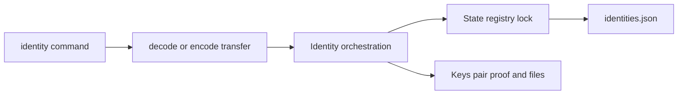

# CLI identity ownership

Identity owns local identity selection and the coordination between the State registry, per-subject
Keys, and IdP sessions. State owns durable registry decoding and locking; Keys owns JWK admission,
pair proof, and private files. Commands own prompts and presentation, not persistence mechanics.

Identity transfer accepts the V1 and V2 envelopes, as plaintext JSON or compact JWE. Unversioned
and unknown versions are rejected. Export writes V2: the key identity with every Kernel registration
it holds, the `(iss, sub)` keyed by the exact Kernel issuer it was registered on, so the imported
identity signs exactly what the exporting one signs on each Kernel. A V1 envelope carries no
registrations and imports with none; the CLI never derives one. Admission completes before mutation.
Import checks the registry under its file lock, persists the admitted keypair, and only then
publishes the identity entry with the envelope's registrations. Export proves the stored pair,
admits its own envelope as import would, and atomically writes one mode-`0600` user-selected file.

The canonical plaintext structures are independently published as
`https://schemas.astrale.ai/cli/identity-export/1` and `https://schemas.astrale.ai/cli/identity-export/2`.
Both are strict, so V2 is a new version rather than a V1 extension that earlier readers would refuse
as malformed. A production Host may emit the V1 envelope as its bootstrap root secret, but CLI
Identity remains the format owner and cryptographically proves the pair on import. The governing bootstrap flow imports the root as `platform-root`, authenticates it
directly to the `platform-manager` Kernel, and reaches a child only through a manager-minted
child-audience Management carrier. The carrier's outer subject is not the child's effective
principal; authenticated child `Identity.whoami` owns that projection.

Identity registration prepares a primary self credential and a Register request for an explicit
existing Node. It never allocates a Node or changes business properties. Direct registration
submits it to Kernel Auth under the selected caller's authority. An
explicit `--via <callable>` instead sends those exact bytes through the Domain that owns an
application Identity Class. The Domain callable owns admission and effect authority; CLI admits only
the selected Node and expected Authentication from the response before persisting its target-bound
`(issuer, subject)`. A local cached registration never substitutes for verifying a newly selected Node.
The stable request key includes the Kernel, Node, derived issuer and publication key slot; retrying
registration cannot create a duplicate business object.

