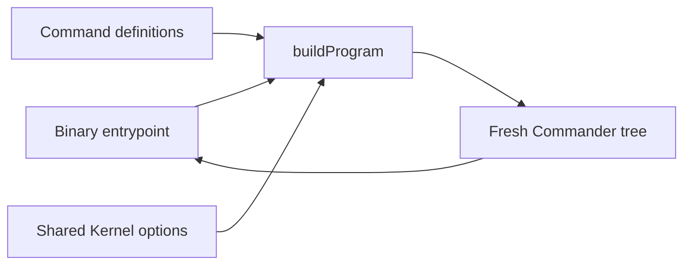

# CLI program architecture

The program module owns Commander composition, not command effects or process lifecycle. It loads
the existing command definitions only when `buildProgram` runs, attaches the single shared Kernel
option set, and returns a fresh unparsed tree. Command modules own their actions; the binary owns
argv, telemetry, signal, error, and exit handling.

A command refuses by throwing an `AstraleError`, whose code, message, and hint the person can act
on; `fatal` accepts nothing else. A broken invariant throws an `InternalError`. Whatever reaches the
binary is reported once by `reportFailure`: a typed failure with its own code, an SDK failure with
the code of its kind, and any other value as `UNEXPECTED_ERROR`, without source or stack.

The module is private to the CLI package. The exhaustive user-facing grammar remains the generated
Commander inventory rather than a duplicate declaration tree.
